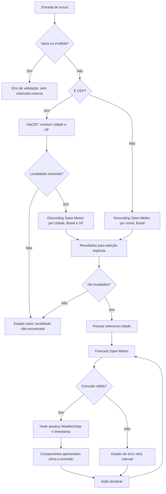

# Plano Técnico — Weather App

Este plano deriva da [especificação do produto](../specs/weather-app-spec.md), que é a fonte da verdade para escopo e critérios de aceite. Ele define arquitetura e contratos, sem implementar o código final.

## Architecture

A aplicação será uma SPA React em camadas simples:

- **Apresentação (`components/`)**: exibe busca, seleção de localidade, clima, previsão e estados da interface. Não acessa APIs nem contém regras de conversão.
- **Orquestração (`hooks/`)**: coordena busca, seleção, consulta, atualização e estado da tela. Mantém a unidade escolhida durante a sessão.
- **Acesso a dados (`services/`)**: encapsula as chamadas ao ViaCEP e Open-Meteo, valida respostas externas e as converte para os contratos internos.
- **Lógica pura (`lib/`)**: contém conversões de temperatura, mapeamento de códigos meteorológicos, normalização/validação e formatação.
- **Tipos (`types/`)**: declara contratos compartilhados entre as camadas.

Essa separação permite testar regras puras sem React, serviços com `fetch` simulado e componentes sem depender da rede (FR-01–FR-06, NFR-05).

## Tech Stack

| Tecnologia | Uso e justificativa |
|---|---|
| TypeScript strict | Contratos explícitos para dados parcialmente disponíveis e integração com APIs externas. |
| React + Vite | SPA responsiva com ciclo de desenvolvimento e build simples. |
| Tailwind CSS | Implementação do tema dark glassmorphism e layouts responsivos previstos pelo projeto. |
| Vitest + Testing Library | Testes unitários e de componentes próximos à experiência da pessoa usuária. |
| Playwright | Validação de fluxos completos e viewport móvel em navegadores reais. |
| Biome | Lint e formatação conforme a configuração do repositório. |
| Open-Meteo e ViaCEP | Dados meteorológicos sem API key e resolução de CEP para cidade/UF. |

O cliente acessa os provedores diretamente pelo navegador; não há backend, conta ou persistência no escopo do MVP. Os CEPs não devem ser incluídos em logs, mensagens de erro, armazenamento local ou estado persistido (NFR-09).

## Project Structure

```text
src/
  components/
    SearchBar.tsx
    CityResults.tsx
    CurrentWeather.tsx
    ForecastList.tsx
    ForecastCard.tsx
    UnitToggle.tsx
    RefreshButton.tsx
    states/
      LoadingState.tsx
      EmptyState.tsx
      ErrorState.tsx
  hooks/
    useWeather.ts
  services/
    viacepService.ts
    geocodingService.ts
    weatherService.ts
  lib/
    temperature.ts
    weatherCodes.ts
    format.ts
    brazilianStates.ts
  types/
    weather.ts
  styles/
    index.css
```

`CityResults` exige seleção explícita quando houver resultados; nenhum resultado será selecionado automaticamente. `brazilianStates.ts` fornece a correspondência entre siglas UF do ViaCEP e nomes de estado retornados pelo geocoding, necessária para restringir buscas por CEP. A estrutura mantém o escopo alinhado às convenções do projeto, sem introduzir store global, camada de repositório ou biblioteca de estado.

## Data Model

Os valores meteorológicos internos usam Celsius, km/h e mm, independentemente da unidade escolhida para apresentação. Campos opcionais/nullables representam explicitamente dados não fornecidos pelo provedor; a UI os apresenta como indisponíveis em vez de inventar valores (AC-02.3, AC-03.4).

```ts
export type Unit = 'celsius' | 'fahrenheit';

export interface City {
  id: number | string; // Identificador do resultado do geocoding.
  name: string; // Nome da cidade.
  state: string; // Estado ou região legível para apresentação.
  stateCode?: string; // Sigla UF, quando disponível.
  country: string; // País, para distinguir localidades homônimas.
  latitude: number; // Latitude usada na consulta meteorológica.
  longitude: number; // Longitude usada na consulta meteorológica.
  timezone: string; // Fuso local da cidade retornado pela Open-Meteo.
}

export interface CurrentWeather {
  time: string; // Horário local da observação informado pelo provedor.
  temperatureC: number | null; // Temperatura atual em Celsius.
  apparentTemperatureC: number | null; // Sensação térmica em Celsius.
  relativeHumidity: number | null; // Umidade relativa em porcentagem.
  windSpeedKmh: number | null; // Velocidade do vento em km/h.
  precipitationMm: number | null; // Precipitação atual em mm.
  weatherCode: number | null; // Código WMO usado para descrição e ícone.
  isDay: boolean | null; // Indica se a observação corresponde ao período diurno.
  temperatureMaxC: number | null; // Máxima do dia local em Celsius.
  temperatureMinC: number | null; // Mínima do dia local em Celsius.
}

export interface ForecastDay {
  date: string; // Data local da cidade no formato ISO (YYYY-MM-DD).
  weatherCode: number | null; // Código WMO da condição diária.
  temperatureMaxC: number | null; // Máxima do dia em Celsius.
  temperatureMinC: number | null; // Mínima do dia em Celsius.
  precipitationProbability: number | null; // Probabilidade máxima em porcentagem.
  precipitationSumMm: number | null; // Volume previsto para o dia em mm.
}

export interface WeatherData {
  city: City; // Localidade explicitamente selecionada.
  current: CurrentWeather; // Condições atuais e extremos do dia.
  forecast: ForecastDay[]; // Hoje e os quatro dias locais seguintes.
  fetchedAt: string; // Instante da última consulta bem-sucedida em ISO.
}
```

Descrição em pt-BR e ícone são derivados de `weatherCode` por uma função pura; não duplicar esses dados no contrato persistido. A unidade `Unit` altera apenas a apresentação das temperaturas: conversão Celsius/Fahrenheit ocorre durante a renderização e não modifica a resposta meteorológica nem dispara nova consulta (FR-04).

## Data Flow

1. A pessoa envia um nome de cidade ou CEP. O formulário remove espaços externos; entrada vazia é rejeitada localmente.
2. Se a entrada tiver formato de CEP, normalize para oito dígitos e valide antes de qualquer chamada. Consulte o ViaCEP; se não houver cidade/UF, finalize como vazio e não chame o Open-Meteo.
3. Para CEP resolvido, procure cidade e UF no geocoding da Open-Meteo,
   restringindo o país ao Brasil e comparando o estado normalizado com a UF.
   Para nome de cidade, procure diretamente no Brasil e retenha somente
   resultados cujo nome corresponda exatamente ao termo após normalização; não
   apresente candidatos apenas aproximados.
4. Apresente os resultados com cidade, estado e país. Resultado vazio exibe mensagem apropriada; múltiplos resultados sempre exigem escolha explícita.
5. Após seleção, consulte o forecast pelas coordenadas do resultado selecionado.
6. Normalize a resposta para `WeatherData` e atualize o hook com timestamp de sucesso.
7. Componentes exibem os campos disponíveis, a descrição/ícone traduzidos e temperaturas convertidas para a unidade corrente.
8. Atualizar repete somente a consulta meteorológica da cidade selecionada. Busca e retry são ações manuais; não há atualização periódica nem retry automático.



## External APIs

Todas as chamadas usam `fetch` com `AbortController` e timeout definido neste plano em **10 segundos por requisição**. O limite é uma proteção contra requisições travadas, não uma promessa de desempenho; o alvo NFR-02 (p95 até 2 segundos em conexão estável) deve ser medido separadamente.

### ViaCEP — resolução de CEP

- **URL:** `https://viacep.com.br/ws/{cep}/json/`
- **Parâmetro:** `cep` normalizado para oito dígitos, sem hífen. Não chamar para formato inválido.
- **Resposta resumida:**

```json
{
  "cep": "01001-000",
  "logradouro": "Praça da Sé",
  "localidade": "São Paulo",
  "uf": "SP",
  "erro": false
}
```

Tratar `erro: true`, cidade/UF ausentes, status HTTP não bem-sucedido, falha de rede e timeout como falha de resolução. Não enviar CEP à Open-Meteo; usar apenas cidade e UF na busca subsequente. Não registrar o CEP nem colocá-lo em mensagens de erro.

### Open-Meteo Geocoding — localizar cidade

- **URL:** `https://geocoding-api.open-meteo.com/v1/search`
- **Parâmetros:** `name` (cidade ou localidade), `count` limitado (por exemplo, 10), `language=pt`, `format=json`, `countryCode=BR`.
- **Resposta resumida:**

```json
{
  "results": [{
    "id": 3448439,
    "name": "São Paulo",
    "admin1": "São Paulo",
    "country": "Brasil",
    "country_code": "BR",
    "latitude": -23.55,
    "longitude": -46.63,
    "timezone": "America/Sao_Paulo"
  }]
}
```

Mapear `id`, `name`, `admin1`, `country`, coordenadas e `timezone` para
`City`. Para busca por CEP, comparar `admin1` com o nome do estado associado à
UF, após normalização de acentos, caixa e espaços, e manter somente
correspondências brasileiras.

Para busca por nome, normalizar o termo e cada `name` retornado removendo
diferenças de acentos, caixa e espaços repetidos. Retornar somente nomes
exatamente iguais após essa normalização; descartar resultados apenas
aproximados, como nomes que contenham o termo ou compartilhem parte dele. Se
houver localidades homônimas com correspondência exata, manter todas e
apresentar estado e país para seleção explícita; nunca escolher automaticamente
a primeira.

### Open-Meteo Forecast — clima atual e cinco dias

- **URL:** `https://api.open-meteo.com/v1/forecast`
- **Parâmetros:** `latitude` e `longitude` da cidade selecionada; `current=temperature_2m,relative_humidity_2m,apparent_temperature,is_day,precipitation,weather_code,wind_speed_10m`; `daily=weather_code,temperature_2m_max,temperature_2m_min,precipitation_probability_max,precipitation_sum`; `temperature_unit=celsius`; `wind_speed_unit=kmh`; `precipitation_unit=mm`; `timezone=auto`; `forecast_days=5`.
- **Resposta resumida:**

```json
{
  "timezone": "America/Sao_Paulo",
  "current": {
    "time": "2026-10-28T09:00",
    "temperature_2m": 22.4,
    "relative_humidity_2m": 68,
    "apparent_temperature": 23.1,
    "is_day": 1,
    "precipitation": 0.0,
    "weather_code": 2,
    "wind_speed_10m": 8.5
  },
  "daily": {
    "time": ["2026-10-28", "2026-10-29"],
    "weather_code": [2, 61],
    "temperature_2m_max": [25.0, 23.0],
    "temperature_2m_min": [17.0, 18.0],
    "precipitation_probability_max": [10, 70],
    "precipitation_sum": [0.0, 8.2]
  }
}
```

O exemplo é abreviado; a resposta real deve conter até cinco datas em `daily.time`. Mapear os valores escalares de `current` e os valores indexados paralelamente pelos arrays diários para os tipos internos. Usar a primeira data local e os valores de mínima/máxima do índice zero para os extremos do dia em `CurrentWeather`. Converter `current.is_day` (`1`/`0`) para boolean. Usar `timezone=auto` e as datas retornadas pelo serviço; não calcular os dias pelo fuso do dispositivo. Validar a presença e os tipos das propriedades antes do mapeamento. Campos isolados ausentes ou inválidos tornam-se `null`, sem descartar campos válidos; resposta estruturalmente inválida ou sem dados utilizáveis é erro da consulta. Registrar `fetchedAt` como instante ISO e formatá-lo em pt-BR na interface.

## State Management

O hook `useWeather` é a única fonte do estado de consulta, sem store global. O estado inclui status, resultados de geocoding, cidade selecionada, dados da última consulta bem-sucedida, unidade e erro acionável. A unidade começa em `celsius`, permanece apenas em memória durante a sessão e não é salva em storage.

Estados explícitos:

- `idle`: nenhuma busca submetida.
- `loading`: validação assíncrona, geocoding ou forecast em andamento; indicar a etapa sem bloquear a operação por teclado.
- `success`: dados da cidade selecionada disponíveis.
- `error`: uma chamada falhou. Se houver dados anteriores da mesma cidade, preservá-los apenas em memória, exibir seu horário e sinalizá-los como desatualizados; nunca os apresentar como atuais.
- `empty`: busca válida sem localidade correspondente, incluindo CEP não encontrado ou geocoding sem resultados.

Uma busca mais recente invalida a anterior. Usar `AbortController` quando possível e um identificador monotônico de requisição para impedir que respostas atrasadas substituam o estado mais novo (AC-05.4). Mudança de cidade limpa os dados da cidade anterior como dados correntes; atualização com falha pode manter os últimos dados da mesma cidade identificados como desatualizados (AC-05.6). Mostrar `fetchedAt` em pt-BR e sinalizar desatualização quando a idade ultrapassar 40 minutos (FR-05, NFR-04).

A conversão Celsius/Fahrenheit é uma função pura aplicada a cada campo de temperatura ao renderizar. Umidade, vento e precipitação não são convertidos. O valor original em Celsius é mantido, evitando conversões acumuladas e novas chamadas de API.

## Error Handling

- **Entrada vazia/inválida:** informar o problema localmente, preservar a privacidade do CEP e não chamar serviços externos.
- **ViaCEP sem correspondência:** apresentar resultado vazio claro e não chamar o Open-Meteo.
- **Geocoding sem resultados:** informar localidade não encontrada e permitir nova busca.
- **Falha HTTP, rede ou timeout:** identificar qual etapa não pôde ser concluída sem expor stack traces ou CEP; oferecer retry manual, sem repetição automática.
- **Resposta parcial:** marcar somente os campos ausentes como indisponíveis e exibir os demais dados válidos (AC-02.3, AC-03.4).
- **Resposta estruturalmente inválida:** tratar como erro da consulta; não renderizar valores fictícios.
- **Busca concorrente:** cancelar a chamada anterior quando possível e sempre descartar respostas obsoletas.
- **Atualização malsucedida:** conservar, se existente, somente o último resultado em memória da mesma cidade, indicando hora e condição desatualizada; sem dados anteriores, exibir erro sem conteúdo meteorológico.
- **Atualização após 40 minutos:** sinalizar visualmente como desatualizado. Não atualizar automaticamente.

## Testing Strategy

### Vitest e Testing Library

- Funções puras: validação/normalização do CEP, normalização e correspondência de UF, conversão Celsius/Fahrenheit (incluindo valores negativos e extremos), mapeamento de códigos WMO e formatação pt-BR com fuso da cidade.
- Services com `fetch` mockado: URLs e parâmetros corretos; mapeamento das
  respostas; campos ausentes; resposta vazia; status HTTP inválido; falha de
  rede e timeout. No geocoding por nome, verificar correspondência exata após
  normalização de acentos, caixa e espaços, descarte de resultados apenas
  aproximados e preservação de homônimos exatos. Verificar que CEP não é enviado
  ao geocoding e não é incluído em mensagens/logs.
- Hook: estados `idle`, `loading`, `success`, `error` e `empty`; retry manual; atualização preservando dados antigos como desatualizados; rejeição de resposta obsoleta; mudança de unidade sem nova consulta.
- Componentes: busca por nome e CEP, seleção explícita, teclado/labels, loading, erro, vazio e sucesso; indisponibilidade de campos sem ocultar os demais; alternância de todas as temperaturas e preservação de unidades de vento, umidade e precipitação; sinalização e horário de dados antigos.

### Playwright

- Fluxo de busca por cidade, seleção de resultados, consulta de clima e previsão, alternância de unidade e atualização manual.
- Fluxo de CEP válido e inválido, localidade inexistente, falha de serviço e retry manual, sem retry automático.
- Verificar que uma falha de atualização não apresenta dados antigos como atuais.
- Validar viewport móvel a partir de 320 px, sem rolagem horizontal, e operação essencial por teclado.
- Usar respostas de rede controladas para resultados determinísticos; complementar com teste técnico separado de integração dos provedores e cobertura de CEPs, questão pendente na spec.

Os critérios devem ser ligados aos ACs correspondentes e as verificações de acessibilidade devem combinar ferramentas automatizadas com testes manuais de teclado e leitor de tela (NFR-05).

## Risks & Trade-offs

| Decisão / risco | Trade-off e mitigação |
|---|---|
| Acesso direto do navegador aos provedores | Evita backend e API key para o MVP, mas disponibilidade e latência dependem de terceiros. Timeout por requisição de 10 s; erro explícito e retry manual. |
| ViaCEP seguido de geocoding | Permite buscar CEP sem transmitir o CEP à Open-Meteo; cobertura e equivalência cidade/UF precisam de teste técnico, conforme questão aberta da spec. |
| Correspondência de estado por mapeamento UF/nome | Evita selecionar outra cidade com nome igual em outro estado; exige manter e testar uma tabela pequena de estados brasileiros e normalização de texto. |
| Cinco dias solicitados com `timezone=auto` | Atende ao calendário local e simplifica a API; a apresentação deve usar as datas retornadas e tratar respostas menores que cinco dias sem inventar entradas. |
| Dados em Celsius no modelo interno | Simplifica conversão e garante que alternar unidade não afete outros campos; conversão ocorre apenas na apresentação. |
| Dados anteriores mantidos só em memória | Permite mostrar contexto após falha durante a sessão sem cache persistente; desaparecem ao recarregar ou encerrar a sessão. |
| Timeout de 10 segundos por requisição | Previne espera indefinida, mas não garante o p95 de 2 segundos. Medir a experiência bem-sucedida conforme ambiente de referência definido no plano de validação. |
| Sem store global ou biblioteca de estado | Mantém o MVP simples, já que há uma localidade ativa; revisar se o escopo futuro incluir múltiplas cidades ou sincronização. |

## Revisão do plano (P4.8)

- **Cobertura:** os requisitos FR-01–FR-06, critérios AC-01.1–AC-05.8 e NFR-01–NFR-09 relevantes foram refletidos em arquitetura, fluxo, estado, erros e testes.
- **Decisões concluídas:** timeout definido em 10 segundos por requisição; busca por CEP usa ViaCEP, filtra Brasil/UF no geocoding e só então permite seleção; datas usam fuso informado pela Open-Meteo; nenhuma escolha de cidade é automática.
- **Aderência às instruções:** preserva React/Vite, TypeScript strict, Tailwind, Vitest/Testing Library, Playwright, Biome, separação `components/hooks/services/lib/types`, estados explícitos, acessibilidade e narrativa/documentação em pt-BR.
- **Sem over-engineering identificado:** não adiciona backend, persistência, store global, cache permanente ou repetição automática, todos desnecessários ou fora do escopo atual.
- **Pontos a validar antes do aceite final:** cobertura de CEPs e correspondência de cidades/UF no ViaCEP/Open-Meteo; alvo de performance exige definir dispositivo de referência; usabilidade exige definir protocolo e amostra. Esses pontos permanecem conforme as questões abertas da spec e não impedem a decomposição em tarefas.
